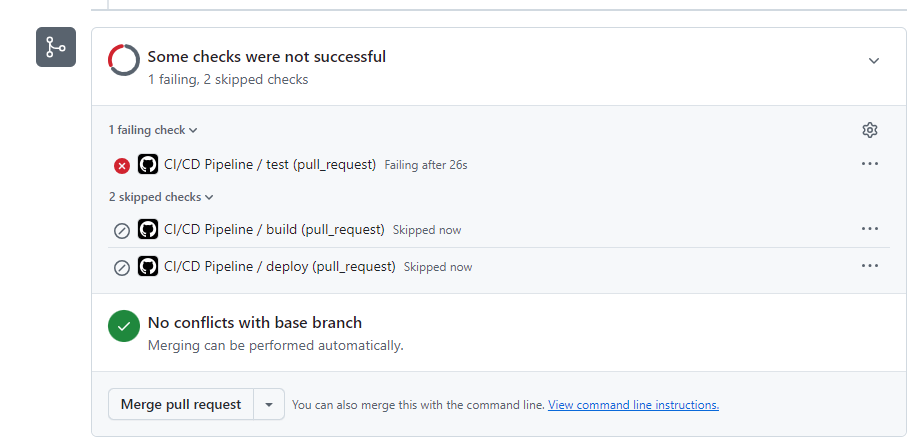

# Binggge 

Petite application full-stack de suivi de séries développée dans le cadre de la ressource d'automatisation de la chaîne de production et de déploiement continu (BUT Informatique). Elle permet de rechercher des séries, de les ajouter à sa watchlist personnelle, d'afficher les synopsis détaillés et d'assurer le suivi de visionnage des œuvres.

Le projet est composé d'une API en Node.js (Express), d'une base de données PostgreSQL conteneurisée et d'une interface web (HTML/CSS/JS vanilla) directement distribuée par l'API pour s'intégrer sans conflit derrière le reverse-proxy Traefik.

---

## URL de production

L'application et son API sont déployées et accessibles en ligne sur le serveur de l'IUT :
- **Lien Application (Prod) :** [https://iut.cafeclaudie.fr/Frey101/](https://iut.cafeclaudie.fr/Frey101/)
- **Healthcheck :** [https://iut.cafeclaudie.fr/Frey101/health](https://iut.cafeclaudie.fr/Frey101/health)

---

## Démarrage rapide

### 1. Avec Docker Compose (Environnement complet)
1. Créer un fichier `.env` à la racine (non versionné) :
   ```env
   DB_PASS=Votre_mot_de_passe
   ```
2. Lancer la base de données et l'API avec Docker :
   ```bash
   docker compose up -d --build
   ```
   L'application complète (Front-end + API) est directement joignable sur [http://localhost:3000](http://localhost:3000).

### 2. Ou lancer l'API directement avec Node en local
1. Lancer uniquement le conteneur de base de données :
   ```bash
   docker compose up -d db
   ```
2. Installer les dépendances et exécuter l'application :
   ```bash
   cd api
   npm install
   npm run dev
   ```
   L'application est accessible sur [http://localhost:3000](http://localhost:3000).

---

## Configuration des ports & Routage (Local vs Production)

- **Sur le serveur (Prod) :** Aucun port applicatif n'est publié vers l'extérieur (`ports:` est proscrit sur le serveur partagé). Le service `api` utilise `expose: - "3000"` pour que Traefik achemine le trafic HTTPS public (`/Frey101/`) directement vers le conteneur Node.js.
- **En local :** Le fichier `docker-compose.yml` expose les ports nécessaires (`3000:3000` pour le web/API et `5433:5432` pour PostgreSQL) afin de faciliter les tests et le débogage direct.
- **Routage Frontend intégré :** Pour éviter tout conflit de routage ou erreur `Cannot GET /` avec Traefik, les fichiers statiques de l'interface (`index.html`, `style.css`) sont hébergés dans `api/public/` et servis directement via `express.static('public')`.

---

## Base de données

La base de données PostgreSQL (version 16) tourne dans un conteneur géré par Docker Compose.

- **Schéma initial :** Défini dans `api/db/schema.sql` (tables `users` et `watchlist`). Pour l'appliquer :
  - **En local :**
    ```bash
    docker compose exec -T db psql -U postgres -d binggge < api/db/schema.sql
    ```
  - **Sur le serveur distant :**
    ```bash
    cat api/db/schema.sql | sudo binggge exec -T db psql -U postgres -d binggge
    ```

---

## Authentification

 **Pas d'authentification réelle, l'en-tête `X-User` tient lieu d'identité.**

### Pourquoi ce choix ?
Le but est de mettre en place la production, la conteneurisation, les tests automatisés et le déploiement continu, sans tout la complexité d'un vrai système d'authentification.

L'en-tête HTTP `X-User` permet simplement de savoir qui fait appelle à l'API, d'isoler les données propres à chaque compte en base de données, et de tester les cas de refus d'accès (`401 Unauthorized`) lorsque l'en-tête est manquant.

---

## Routes de l'API

| Méthode | Route | En-tête requis | Corps (JSON) | Description |
|---|---|---|---|---|
| `GET` | `/health` | Aucun | Aucun | Vérifie que l'API est en ligne (renvoie `{"status":"ok"}`). |
| `GET` | `/shows?q=<recherche>` | Aucun | Aucun | Recherche TVMaze avec synopsis formaté (id, title, year, image, summary). |
| `POST` | `/register` | Aucun | `{"login":"nom"}` | Crée un nouvel utilisateur en base (201 si créé, 400 si invalide). |
| `GET` | `/watchlist` | `X-User: <login>` | Aucun | Renvoie la liste des séries de l'utilisateur (401 si absent). |
| `POST` | `/watchlist` | `X-User: <login>` | `{"show_id": 1, "title": "Nom"}` | Ajoute une série en watchlist (400 si titre vide, 401 si sans header). |
| `PUT` | `/watchlist/:id/seen` | `X-User: <login>` | `{"seen": true}` | Met à jour le statut de visionnage de la série (vu / à regarder). |
| `DELETE` | `/watchlist/:id` | `X-User: <login>` | Aucun | Supprime la série de la watchlist de l'utilisateur. |

### Exemples d'appels cURL

```bash
# Vérification de santé
curl https://iut.cafeclaudie.fr/Frey101/health

# Recherche de séries avec synopsis
curl "https://iut.cafeclaudie.fr/Frey101/shows?q=severance"

# Inscription d'un utilisateur
curl -X POST https://iut.cafeclaudie.fr/Frey101/register \
  -H "Content-Type: application/json" \
  -d '{"login":"anna"}'

# Ajout à la watchlist
curl -X POST https://iut.cafeclaudie.fr/Frey101/watchlist \
  -H "Content-Type: application/json" \
  -H "X-User: anna" \
  -d '{"show_id":44778,"title":"Severance"}'

# Suppression d'une série
curl -X DELETE https://iut.cafeclaudie.fr/Frey101/watchlist/44778 \
  -H "X-User: anna"

# Accès refusé (sans en-tête X-User -> 401)
curl https://iut.cafeclaudie.fr/Frey101/watchlist
```
---

## Interface Web

L'interface web (html/css) est intégrée directement dans le service Node.js (`api/public/`) :
- **Barre d'authentification :** Création et sélection de profil utilisateur  avec envoi automatique du header `X-User`.
- **Indicateur de statut :** MonIndication de l'état en direct de l'API (En ligne / Déconnecté).
- **Moteur de recherche :** Consultation des séries avec affichage des affiches, années et synopsis déroulants.
- **Gestionnaire de Watchlist :** Affichage de la sélection personnelle, pointage des épisodes vus / non vus et suppression unitaire.

---

## Tests automatisés

Les tests sont écrits avec le framework Jest et Supertest.

Pour les exécuter :
```bash
cd api
npm test
```

### Cas testés :
1. `GET /health` répond un statut 200 avec `{"status":"ok"}`.
2. L'inscription via `POST /register` crée bien l'utilisateur en base de données (201).
3. L'ajout d'une série via `POST /watchlist` avec l'en-tête `X-User` fonctionne (201).
4. L'accès à `GET /watchlist` sans en-tête `X-User` renvoie une erreur 401.
5. L'ajout d'une série avec un titre vide est rejeté avec une erreur 400.


---

## Pipeline CI/CD

Le pipeline GitHub Actions (`.github/workflows/ci.yml`) s'exécute automatiquement sur chaque Pull Request et lors d'un push sur `main` :

```
[ Push / PR sur feat/* ] ──► Test (CI) ──► Build (CI)
                                                    │ (Si push/merge sur main)
                                                    ▼
                                           Deploy (CD via SSH)
```

1. **test (CI) :** Démarre un conteneur PostgreSQL temporaire de test, applique le schéma SQL `api/db/schema.sql`, installe les dépendances avec `npm ci` et exécute la suite de tests (`npm test`).
2. **build (CI) :** Valide la compilation de l'image Docker de l'application via `docker/build-push-action`.
3. **deploy (CD) :** Uniquement déclenché lors du merge sur `main`, se connecte en SSH au VPS (`iut.cafeclaudie.fr`) à l'aide des secrets GitHub (`SSH_DEPLOY_KEY`, `LOGIN`), met à jour le code source (`git pull origin main`) et relance l'ensemble des conteneurs en production (`sudo binggge up -d --build --remove-orphans`).

**Protection de branche :** Aucun push direct n'est autorisé sur `main`. Toute évolution passe obligatoirement par une branche de fonctionnalité (`feat/*`), une Pull Request validée et un pipeline strictement vert.

---

## Gestion d'incident & Qualité

Dans le cadre du défi qualité, une régression volontaire a été injectée (attente erronée d'un code de retour) afin d'éprouver la robustesse de la chaîne d'intégration continue :



Le job de test a immédiatement échoué en rouge sur GitHub Actions, bloquant automatiquement le merge de la Pull Request et empêchant tout déploiement corrupteur sur le serveur distant en production.

---

## Définition de « Fini » (DoD)

Un ticket ou une fonctionnalité est considéré(e) comme terminé(e) uniquement si :
1. Le pipeline CI/CD GitHub Actions est intégralement au vert.
2. L'application répond correctement depuis un réseau et une machine externe à l'environnement de développement.
3. L'issue associée est clôturée suite à la validation d'une Pull Request.

---

## Checklists de validation

### Checklist Séance 1 — Initialisation & Recherche
- [x] **01. Dépôt accessible :** Dépôt GitHub opérationnel et accessible en écriture.
- [x] **02. Branche protégée :** Pushs directs refusés sur `main`, passages obligatoires par PR.
- [x] **03. PR validée :** Pull Request documentée, revue et fusionnée.
- [x] **04. Recherche opérationnelle :** Recherche TVMaze fonctionnelle avec données nettoyées (`curl /shows?q=severance`).
- [x] **05. Suivi & documentation :** Découpage en tickets et jalons avec estimations, README initialisé.

### Checklist Séance 2 — Persistance & Tests
- [x] **01. Tests validés :** Suite de tests automatisés validée au vert via Jest et Supertest.
- [x] **02. Persistance :** Données conservées via volume nommé Docker (`pgdata`).
- [x] **03. Authentification expliquée :** Documentation de l'en-tête `X-User` et justification du choix technique.
- [x] **04. Traçabilité :** Clôture automatique des tickets par PR (`Closes #n`).

### Checklist Séance 3 — Déploiement & Interface Complète
- [x] **01. Réponse distante :** L'URL `https://iut.cafeclaudie.fr/Frey101/` et son endpoint `/health` répondent `200 OK`.
- [x] **02. Pipeline complet :** Chaîne CI/CD automatique enchaînant tests, build et déploiement SSH sur le VPS.
- [x] **03. Défi gestion d'incident :** Régression simulée ayant bloqué la PR sans impacter la production.
- [x] **04. Sécurité des secrets :** Clés SSH et identifiants isolés dans GitHub Secrets (`SSH_DEPLOY_KEY`, `LOGIN`), variables d'environnement gérées via `.env`.
- [x] **05. Frontend complet & pointage :** Interface utilisateur intégrée, affichage des synopsis, suppression unitaire et pointage des épisodes (« Vu / À regarder »).